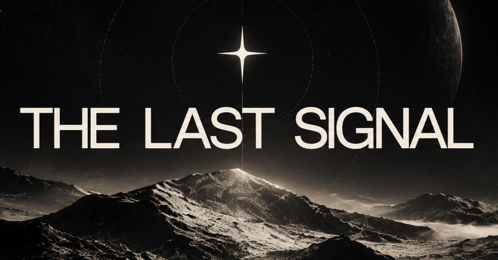

# The Last Signal



**The Last Signal** is an experimental interactive web experience where scrolling becomes part of the narrative.

A mysterious transmission is detected, decoded, reconstructed and eventually lost. Instead of simply moving through sections, the user progressively **decodes the signal through scroll**.

### [View Live Experience](https://arturo0427.github.io/the-last-signal/)

---

## Concept

> A transmission received once. Never repeated.

The project explores how motion, typography, imagery and interaction can work together to create a digital narrative.

The experience progresses through seven states:

1. Searching
2. Signal Detected
3. Decode
4. Decode Peak
5. Message
6. Transmission Failure
7. Signal Lost

The main visual element — the **Signal Line** — evolves throughout the experience from a flat signal into increasingly complex waveforms before returning to silence.

---

## Creative Direction

The visual language combines:

- Scientific archive interfaces
- Contemporary editorial design
- Analog instrumentation
- Digital anomalies
- Cinematic monochrome imagery

The project intentionally avoids traditional sci-fi clichés such as neon terminals, hacker interfaces or excessive glitch effects.

---

## Interaction & Motion

The experience is driven by a GSAP timeline connected to scroll using ScrollTrigger.

Some of the main interactions include:

- Scroll-driven storytelling
- Pinned cinematic sequence
- SVG waveform morphing
- Image mask reveals
- Internal image parallax
- Dynamic signal percentage
- Typographic reconstruction
- Transmission degradation
- Responsive motion choreography
- Reverse animation while scrolling backwards
- Replay transmission interaction
- Reduced-motion support

Desktop and mobile use different motion timings rather than simply scaling the same animation.

---

## Tech Stack

- HTML
- CSS
- JavaScript
- Vite
- GSAP
- ScrollTrigger

Fonts:

- Inter Tight
- IBM Plex Mono

Fonts are self-hosted using Fontsource.

---

## Performance & Accessibility

The project was optimized and tested using Lighthouse.

### Desktop

| Metric | Score |
| --- | ---: |
| Performance | 100 |
| Accessibility | 100 |
| Best Practices | 100 |
| SEO | 100 |

### Mobile

| Metric | Score |
| --- | ---: |
| Performance | 94 |
| Accessibility | 100 |
| Best Practices | 100 |
| SEO | 100 |

Additional optimizations include:

- WebP imagery
- Local font hosting
- Reduced render-blocking dependencies
- `prefers-reduced-motion` support
- Accessible color contrast
- Responsive layouts
- Optimized production build
- Open Graph metadata
- Sitemap and robots configuration

---

## Project Structure

```text
the-last-signal/
├── public/
│   ├── images/
│   │   └── signal-terrain.webp
│   ├── favicon.png
│   ├── og-image.png
│   ├── robots.txt
│   └── sitemap.xml
│
├── src/
│   ├── motion/
│   │   └── transmission.js
│   │
│   ├── styles/
│   │   ├── tokens.css
│   │   ├── base.css
│   │   └── main.css
│   │
│   └── main.js
│
├── index.html
├── package.json
└── vite.config.js
```

---

## Run Locally

Clone the repository:

```bash
git clone https://github.com/arturo0427/the-last-signal.git
```

Install dependencies:

```bash
npm install
```

Start the development server:

```bash
npm run dev
```

Create a production build:

```bash
npm run build
```

Preview the production build:

```bash
npm run preview
```

---

## What I Practiced

This project was built as part of my journey into Creative Web Development.

The main focus was not only learning GSAP syntax, but understanding how to design motion intentionally:

- Planning motion before implementation
- Connecting animation with storytelling
- Building persistent visual elements across scenes
- Using scroll as an interaction mechanism
- Designing different motion behavior for mobile
- Controlling animation intensity
- Maintaining performance while using cinematic motion
- Making creative experiences accessible

---

## Live Site

**The Last Signal**

https://arturo0427.github.io/the-last-signal/

## Contact

[Wilson Arturo Muñoz Ruano](https://www.linkedin.com/in/arturom0427/)

arturo_munoz27@outlook.com